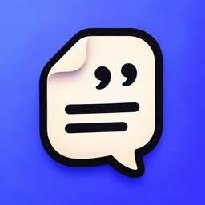
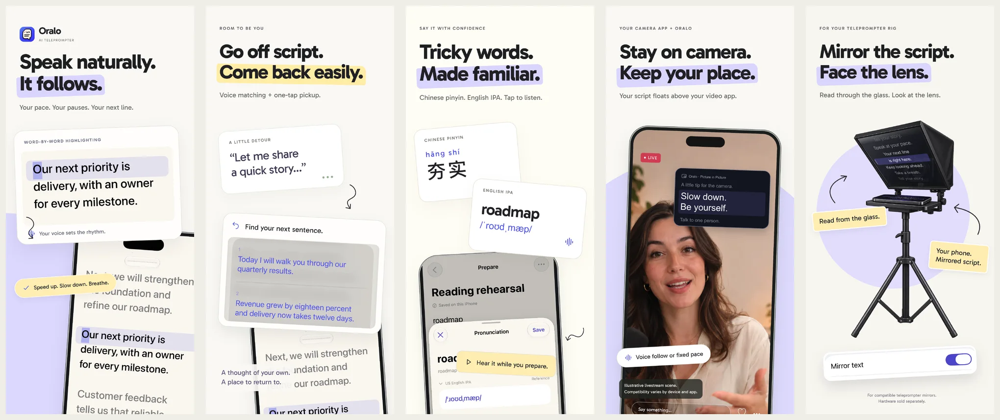

<p align="center">
  <a href="https://oralo.fun/"></a>
</p>
<h1 align="center">Oralo</h1>
<p align="center"><strong>AI Teleprompter, at Your Pace</strong></p>
<p align="center">Look up. Say it your way. Find your next line.</p>
<p align="center">
  English · <a href="README.zh-CN.md">简体中文</a><br>
  <a href="https://oralo.fun/">Website</a> ·
  <a href="https://apps.apple.com/app/id6835449605">App Store</a> ·
  <a href="docs/TECHNICAL.md">How it works</a> ·
  <a href="docs/PRIVACY.md">Privacy</a>
</p>
<p align="center">iPhone &amp; iPad · iOS 18+ · Swift / SwiftUI · MIT</p>

Oralo is an open-source teleprompter for presentations, reports and video creation. It follows your speech, holds your place when you pause or go off script, and helps you pick up the original text again. Prepare difficult words before you speak, then keep your attention on your audience.

<p align="center">
  <a href="docs/assets/screenshots-en.webp"></a>
</p>

## Made for the way you speak

| Feature | What it does |
| --- | --- |
| **Follow your voice** | On-device speech recognition, character-level highlighting and a reading line held near the upper middle of the screen. |
| **Go off script, then return** | Fresh speech can find a distinctive passage elsewhere in your script. Uncertain matches hold position; tap a passage to take control. |
| **Prepare tricky words** | Add Chinese pinyin or English IPA above the original text. Listen to an English reference pronunciation while preparing. |
| **Keep your script in view** | System Picture in Picture offers voice following or fixed-pace scrolling while you use another app. |
| **Read through a mirror** | Mirror the manuscript and pronunciation hints for teleprompter hardware; controls remain readable. |
| **Get ready and rehearse** | Import plain text, edit and save, check readiness, rehearse, review observations and return to the original sentence. |
| **Know the size of your talk** | Script counts and adjustable speaking-time estimates, plus quick-start samples in the app's language. |
| **Make it comfortable** | Portrait and landscape reading, iPad layouts, light and dark appearances, accessibility labels, and native Liquid Glass controls on supported systems. |

The interface supports English, Simplified Chinese and Traditional Chinese. Speech recognition depends on the device, language and installed system models. PiP and simultaneous microphone use depend on iOS and the other app; interrupted input holds the reading position. Rehearsal observations are prompts for review, not pronunciation scores.

## Local by design

**No account. No ads. No analytics SDK. No developer-operated speech server.**

Scripts, pronunciation notes, preferences and rehearsal records are saved on your device. Microphone audio is processed through Apple's on-device speech APIs; Oralo does not save audio recordings or full transcripts. If on-device recognition is unavailable, manual reading remains available without falling back to a cloud recognizer.

System models and voices may need downloading. Files chosen from a cloud provider, user-initiated sharing, external links and system device backups have their own network and storage behavior. Deletion clears the app's relevant recovery copies as well as its current data; exported copies and system backups are outside that operation.

Read the [data-handling details](docs/PRIVACY.md) or inspect the [speech](oralo-ios/Oralo/Speech/) and [storage](oralo-ios/Packages/OraloCore/Sources/OraloCore/ScriptLibraryRepository.swift) implementations.

## Build it yourself

The verified toolchain is **Xcode 27.1**, with its iOS SDK and a simulator runtime. The deployment target is **iOS 18.0**. `OraloCore` uses Swift tools 6.2 or later. The project uses Apple frameworks and an included local Swift package; **no API key or backend setup is needed**.

1. Open `oralo-ios/Oralo.xcodeproj` in Xcode.
2. Select the **Oralo** scheme and an iPhone or iPad simulator, then run.
3. For a physical device, choose your own development team and unique bundle identifier in **Signing & Capabilities**. Configure the UI test target too when running device tests.

From the repository root:

```sh
xcodebuild -project oralo-ios/Oralo.xcodeproj \
  -scheme Oralo -configuration Debug \
  -destination 'generic/platform=iOS Simulator' \
  CODE_SIGNING_ALLOWED=NO build

swift test --package-path oralo-ios/Packages/OraloCore
```

See the [iOS development guide](oralo-ios/README.md) for the source map and testing workflow.

## How it works

Oralo combines on-device recognition with local text alignment. A confirmed script position is kept separate from a small, bounded visual prediction, helping the highlight feel responsive without treating an estimate as recognized speech. The PiP reader reuses the same speech-following pipeline.

The [technical guide](docs/TECHNICAL.md) explains matching and off-script recovery, recognition-delay compensation, character highlighting, PiP rendering and audio-session coordination, with links to the implementation and tests.

## Feedback and contributions

Use [GitHub Issues](https://github.com/CH563/oralo/issues) for reproducible problems or suggestions, and the [support page](https://oralo.fun/support/) for help. Include the iOS version, device type and steps to reproduce. Use sample scripts instead of private manuscripts; review diagnostics before sharing them.

For changes to speech following, add or update a focused core test and describe the physical-device checks. Simulator fixtures do not establish real microphone latency or camera compatibility.

## License

[MIT](LICENSE). Third-party pronunciation data retains its own licenses and attribution; see [pronunciation credits](oralo-ios/Oralo/Pronunciation/Resources/Pronunciation-Credits.txt).
