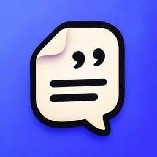

<p align="center">
  <a href="https://oralo.fun/"></a>
</p>
<h1 align="center">接着讲 · Oralo</h1>
<p align="center"><strong>跟随你的 AI 提词器</strong></p>
<p align="center">抬头，自在地讲。低头，下一句还在。</p>
<p align="center">
  <a href="README.md">English</a> · 简体中文<br>
  <a href="https://oralo.fun/">官网</a> ·
  <a href="https://apps.apple.com/app/id6835449605">App Store</a> ·
  <a href="docs/TECHNICAL.zh-CN.md">技术说明</a> ·
  <a href="docs/PRIVACY.zh-CN.md">隐私说明</a>
</p>
<p align="center">iPhone 与 iPad · iOS 18 及以上 · Swift / SwiftUI · MIT 开源</p>

接着讲是一款面向现场分享、工作汇报和视频创作的开源提词器。它跟随你的语速，在停顿或自由发挥时保留位置，帮助你重新接回原稿。提前准备难读的字词，开讲时把注意力留给听众。

<p align="center">
  <a href="docs/assets/screenshots-zh-CN.webp"></a>
</p>

## 按你的节奏讲

| 功能 | 带来的帮助 |
| --- | --- |
| **语音跟随** | 设备端识别、逐字高亮，让当前阅读行保持在屏幕中上区域。 |
| **自由发挥后接稿** | 根据新说出的内容寻找原稿中的明确位置；匹配不确定时停住，也可以点按原句接回。 |
| **中文拼音与英文音标** | 注音显示在原文字词上方，备稿时可试听英文参考发音。 |
| **跨 App 小窗** | 使用系统画中画，在其他 App 上方查看讲稿，可选择语音跟随或定速滚动。 |
| **镜像提词** | 正文和注音左右镜像，搭配镜面提词设备使用；操作按钮保持正常。 |
| **从备稿到复盘** | 纯文本导入、编辑保存、准备检查、排练、复盘，再回到原句修改。 |
| **预估演讲时长** | 显示稿件字数和预计用时，可调整估算语速；快速示例匹配 App 语言。 |
| **舒适阅读** | 横竖屏、iPad 布局、浅色与深色、无障碍标签，以及受支持系统上的原生液态玻璃控件。 |

界面支持英文、简体中文和繁体中文。设备端语音能力取决于设备、语言和系统模型；画中画与同时收音取决于 iOS 和配合使用的 App，收音中断时会保留位置。排练观察用于帮助复查，不是发音评分。

## 数据留在本机

**无账号、无广告、无统计 SDK，不使用开发者运营的语音服务器。**

讲稿、注音、偏好与排练记录保存在设备上。麦克风音频通过 Apple 设备端语音接口处理，Oralo 不保存录音或识别全文。设备端识别不可用时仍可手动提词，不会改为云端识别。

系统模型与声音可能需要下载；用户选择云盘文件、主动分享、打开外部链接，以及系统设备备份，有各自的联网与保存行为。删除操作会同时清理 App 对应的本机恢复副本，但不删除已经导出的文件或系统备份。

查看[完整数据处理说明](docs/PRIVACY.zh-CN.md)，也可以直接阅读[语音处理](oralo-ios/Oralo/Speech/)和[稿件存储](oralo-ios/Packages/OraloCore/Sources/OraloCore/ScriptLibraryRepository.swift)源码。

## 自行构建

已验证工具链为 **Xcode 27.1**，需要配套 iOS SDK 与模拟器运行时；最低部署系统为 **iOS 18.0**。`OraloCore` 使用 Swift tools 6.2 或以上。工程只依赖 Apple 系统框架和仓库内的本地 Swift 包，**无需 API Key 或后端配置**。

1. 在 Xcode 中打开 `oralo-ios/Oralo.xcodeproj`。
2. 选择 **Oralo** scheme 和一个 iPhone 或 iPad 模拟器，运行。
3. 真机运行时，在 **Signing & Capabilities** 中选择自己的开发团队和唯一 Bundle ID。运行真机 UI 测试时，也需要配置测试 target。

在仓库根目录运行：

```sh
xcodebuild -project oralo-ios/Oralo.xcodeproj \
  -scheme Oralo -configuration Debug \
  -destination 'generic/platform=iOS Simulator' \
  CODE_SIGNING_ALLOWED=NO build

swift test --package-path oralo-ios/Packages/OraloCore
```

工程结构与测试方式见 [iOS 开发指南](oralo-ios/README.md)。

## 跟随是怎样实现的

Oralo 将设备端语音识别与本地文本对齐结合起来，并把“识别确认的位置”和“短距离的显示预测”分开处理。显示预测用于缓解识别回调延迟，不会把估算位置当成已经读过的内容。小窗复用同一套语音跟随流程。

[技术说明](docs/TECHNICAL.zh-CN.md)介绍了全文接稿、延迟补偿、逐字高亮、PiP 画面生成和音频会话协作，并链接到对应实现与测试。

## 反馈与参与

可通过 [GitHub Issues](https://github.com/CH563/oralo/issues)报告可复现的问题或提出建议，也可查看[支持页面](https://oralo.fun/support/?lang=zh)。请提供 iOS 版本、设备类型与复现步骤，使用示例文本代替私密讲稿，分享诊断信息前先检查内容。

修改语音跟随时，请补充或更新有针对性的核心测试，并说明真机验证情况。模拟器中的固定语音样例不能证明真实收音延迟或相机兼容性。

## 许可证

项目采用 [MIT 许可证](LICENSE)。第三方读音数据保留各自的许可和来源说明，见[读音数据来源](oralo-ios/Oralo/Pronunciation/Resources/Pronunciation-Credits.txt)。
