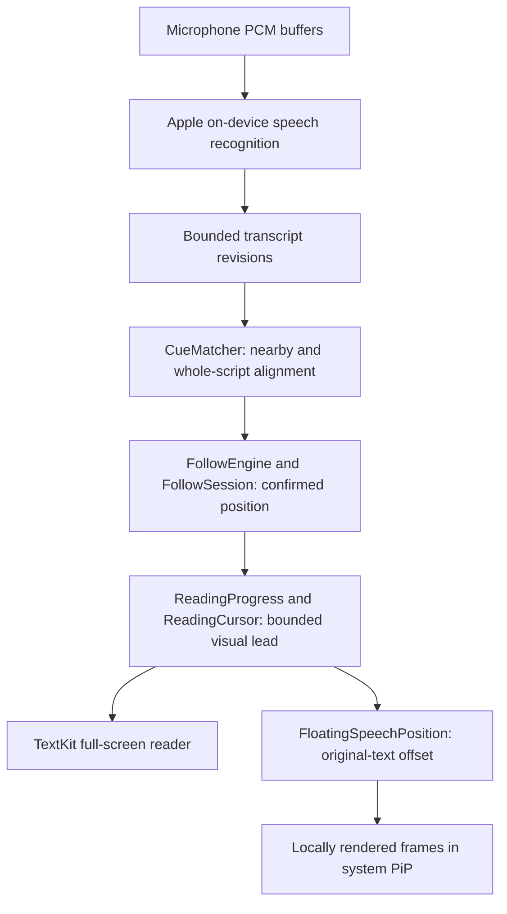

# How Oralo follows your speech

[English](TECHNICAL.md) · [简体中文](TECHNICAL.zh-CN.md) · [Project](../README.md)

This guide describes the implementation shipped in version 1.0, build 14. The app uses Apple speech models for on-device recognition and deterministic local alignment for script positioning. It does not send the script to an LLM or ask a server to decide where to scroll.

## One pipeline, two readers

[`MicrophoneCapture`](../oralo-ios/Oralo/Speech/MicrophoneCapture.swift) copies mono PCM samples out of the audio tap into a bounded asynchronous stream. It does not write an audio file. When a bounded audio stream overflows, the pipeline reports overload instead of silently accumulating a growing backlog.

The speech sources implement the same [`SpeechSource`](../oralo-ios/Oralo/Speech/SpeechSource.swift) contract:

- On supported iOS 26+ devices, [`ModernSpeechSource`](../oralo-ios/Oralo/Speech/ModernSpeechSource.swift) uses `SpeechAnalyzer` and `SpeechTranscriber`, progressive time-indexed results and the `fastResults` reporting option. Missing system models can be downloaded after an explicit action.
- [`LegacySpeechSource`](../oralo-ios/Oralo/Speech/LegacySpeechSource.swift) supports the iOS 18 path. It checks `supportsOnDeviceRecognition`, sets `requiresOnDeviceRecognition = true`, accepts partial results and handles callbacks on a dedicated serial queue. It renews recognition requests without replaying previously captured audio.
- Unsupported on-device recognition is reported to the user. Manual cue selection is available; there is no server-recognition fallback.

For the modern source, [`TranscriptWindow`](../oralo-ios/Packages/OraloCore/Sources/OraloCore/TranscriptWindow.swift) replaces overlapping time ranges instead of appending every partial revision. It retains a bounded window: up to 12 seconds, 32 segments and 768 output characters. Old text must not keep overpowering the latest spoken words.

## Finding the next line and returning after an ad-lib

[`SpeechText`](../oralo-ios/Packages/OraloCore/Sources/OraloCore/SpeechText.swift) prepares tokens for comparison while retaining original character ranges. It handles case, punctuation, common number forms and length-preserving Traditional-to-Simplified Chinese normalization. Pronunciation annotations remain separate metadata; they are not extra words in the matching input.

[`CueMatcher`](../oralo-ios/Packages/OraloCore/Sources/OraloCore/CueMatcher.swift) combines a local window with whole-script retrieval:

1. Always consider the current cue and the next three cues. Ordinary forward reading can respond to partial recognition without waiting for sentence-final results.
2. Use word and adjacent-token indexes to retrieve up to 12 additional candidates across the script. Less common matches contribute more retrieval weight.
3. Align the recent transcript tail to each candidate with a reversed edit-distance calculation. The newest non-filler token must match; a familiar old prefix cannot keep the reader pinned to the first sentence.
4. Reject candidates when the best and second-best matches are too close, or a short exact phrase is ambiguous elsewhere in the script.
5. For distant relocation, use speech newer than the previous move. A distinctive exact match can relocate immediately; fuzzy recovery waits for growing evidence or a final recognition result.

[`FollowEngine`](../oralo-ios/Packages/OraloCore/Sources/OraloCore/FollowEngine.swift) manages that evidence. [`FollowSession`](../oralo-ios/Packages/OraloCore/Sources/OraloCore/FollowSession.swift) accepts ordinary matches within the forward window and explicit relocation evidence elsewhere. Every asynchronous result carries a context token and an increasing sequence number. Pausing, restarting or manually selecting a sentence invalidates old results.

Uncertain speech enters a holding state. That includes genuine ad-libs and recognition errors; the app cannot reliably distinguish them. It keeps the current position until evidence improves or the speaker chooses a sentence manually.

## Reducing perceived delay without inventing recognition

Recognition is not instantaneous. Oralo reduces avoidable waiting and separates the **confirmed position** from the **display position**.

| Mechanism | Effect and limit |
| --- | --- |
| Progressive / partial results | Advance on useful intermediate text instead of requiring a completed utterance. Faster hypotheses can still be revised. |
| Bounded buffers and transcript windows | Avoid processing an ever-growing backlog of audio or repeated transcript revisions. |
| Indexed candidate retrieval | Restrict expensive alignment to a small set of likely passages, while still allowing whole-script recovery. |
| Audio-tail age estimate | Compare captured input time with the latest recognized word end time; smooth and cap the estimate used for display compensation. |
| Adaptive reading-rate estimate | Update a smoothed rate from newly confirmed tokens, with language-aware bounds. |
| Short visual prediction | Project the display cursor a small distance ahead while recent voice activity and advancing matches support it. |
| TextKit updates | Repaint affected ranges and keep the actual reading line near the upper middle instead of rebuilding the whole manuscript every tick. |

[`ReadingProgress`](../oralo-ios/Packages/OraloCore/Sources/OraloCore/ReadingProgress.swift) limits prediction to a horizon of **0.9 seconds**, with at most **6 Han tokens or 2 English words**. Prediction stops after one second without an advancing match. [`ReadingCursor`](../oralo-ios/Packages/OraloCore/Sources/OraloCore/ReadingCursor.swift) also requires voice activity, respects mixed-language/number boundaries and can preview only the immediate next cue. Silence, uncertainty and expired predictions freeze the visible cursor rather than making it flash backward.

The predicted tail has an underline in the full-screen reader. It never changes the confirmed session anchor or marks a passage as recognized. This is character-level presentation, not phoneme-level scoring or a claim of exact karaoke timing.

The UI coordinator, [`SpeechPrototypeModel`](../oralo-ios/Oralo/Prototype/SpeechPrototypeModel.swift), measures callback gaps, matching time and audio-tail age. These are different measurements: matching-time P95 is **not** end-to-end microphone-to-highlight latency, and a return from holding is **not** a measured recovery success rate. There is no universal latency guarantee across devices, languages or audio routes.

[`ScriptReader`](../oralo-ios/Oralo/Prototype/ScriptReader.swift) maps the cursor to actual laid-out text lines. Rotation reflows the reader without replacing the speech session. Mirroring changes the text presentation, including annotation layout, while controls and the logical script position remain normal.

## Cross-app Picture in Picture

The floating prompt uses system AVKit PiP, not an unrestricted overlay window. In build 14, [`FloatingContentController`](../oralo-ios/Oralo/Floating/FloatingContentController.swift) is an `AVPictureInPictureVideoCallViewController`, connected through `AVPictureInPictureController.ContentSource(activeVideoCallSourceView:contentViewController:)`. The class name describes the public AVKit container; Oralo does not establish a CallKit call, network video call or camera session.

[`FloatingFrameRenderer`](../oralo-ios/Oralo/Floating/FloatingFrameRenderer.swift) lays out the original script and pronunciation hints with TextKit, draws into pooled **960 × 540 BGRA pixel buffers**, and wraps them in `CMSampleBuffer` objects. The controller updates the local surfaces at up to **15 frames per second** while moving, and refreshes static content at a lower rate.

Frames use `kCMSampleAttachmentKey_DisplayImmediately`, with no control timebase on the source display layer. The inline source and PiP content each have a display surface. Renderer readiness is checked before enqueueing; failed renderers are flushed for recovery. No MP4 file, network stream or silent audio track is produced.

There are two explicit modes:

- **Fixed pace:** [`FloatingReadingTimeline`](../oralo-ios/Packages/OraloCore/Sources/OraloCore/FloatingReadingTimeline.swift) maps elapsed time to text offsets. The microphone is not used.
- **Voice follow:** [`FloatingSpeechSession`](../oralo-ios/Oralo/Floating/FloatingSpeechSession.swift) reuses the same production speech model, matcher and reading cursor as full-screen mode. [`FloatingSpeechPosition`](../oralo-ios/Packages/OraloCore/Sources/OraloCore/FloatingSpeechPosition.swift) maps cue/character progress back to the original document. The PiP reading lane is not a second, independently scored karaoke highlight.

### Audio and camera coexistence

[`FloatingPromptController`](../oralo-ios/Oralo/Floating/FloatingPromptController.swift) owns the PiP audio session. Voice mode uses `.playAndRecord`, `.measurement` and `.mixWithOthers`; fixed pace uses mixed `.playback`. Its speech capture receives an externally managed session so it cannot overwrite that configuration. Full-screen capture retains its own exclusive session policy.

Voice capture starts while Oralo is foregrounded. The app does not fight another app with repeated background audio activation. Audio interruption or loss of PCM buffers holds the current position; it never silently substitutes fixed-pace scrolling and calls it voice following. The no-buffer watchdog currently uses 2.5 seconds. Audio interruption notifications alone do not stop silent fixed-pace frames.

Returning to Oralo pauses and closes the floating window. Saved checkpoints contain a script identity, revision and position; reopening does not automatically start listening. Deleting the script clears its checkpoint and releases its in-memory rendering/session state.

Build 14 was accepted in physical-device testing for Camera recording, recorded speech, voice following and returning after ad-libs. This is not a guarantee for every camera, livestream or call app. iOS decides PiP availability, placement and size limits, and another app can interrupt microphone access or end PiP. The current renderer fills an opaque background; it does not provide transparent video over the underlying app.

## Pronunciation and storage

Chinese pinyin is editable Foundation transliteration. English IPA is loaded from a bundled dictionary. `AVSpeechSynthesizer` reads the original English word as a reference; it does not synthesize a user's edited IPA string. The review flow lets users check pronunciation themselves and does not automatically declare a word mispronounced.

Drafts, notes and review snapshots remain local. Archive and recovery-copy deletion is coordinated to prevent stale writes or fallback loading from restoring removed content. See [privacy and deletion](PRIVACY.md) for the complete boundary, including system backups and exported copies.

## Tests and practical limits

Run `swift test --package-path oralo-ios/Packages/OraloCore` from the repository root. Useful suites include:

| Tests | What they cover |
| --- | --- |
| [CueMatcherTests](../oralo-ios/Packages/OraloCore/Tests/OraloCoreTests/CueMatcherTests.swift), [SpeechRecoveryTests](../oralo-ios/Packages/OraloCore/Tests/OraloCoreTests/SpeechRecoveryTests.swift) | Distinctive matches, ambiguity, transcript tails and distant recovery |
| [FollowSessionTests](../oralo-ios/Packages/OraloCore/Tests/OraloCoreTests/FollowSessionTests.swift) | Pause/manual navigation, context invalidation and result ordering |
| [ReadingProgressTests](../oralo-ios/Packages/OraloCore/Tests/OraloCoreTests/ReadingProgressTests.swift), [ReadingCursorTests](../oralo-ios/Packages/OraloCore/Tests/OraloCoreTests/ReadingCursorTests.swift) | Bounded prediction, silence, mixed scripts and cue transitions |
| [FloatingReadingTests](../oralo-ios/Packages/OraloCore/Tests/OraloCoreTests/FloatingReadingTests.swift), [FloatingSpeechPositionTests](../oralo-ios/Packages/OraloCore/Tests/OraloCoreTests/FloatingSpeechPositionTests.swift) | Timed offsets, pauses and original-document mapping |
| [LocalDataRemovalTests](../oralo-ios/Packages/OraloCore/Tests/OraloCoreTests/LocalDataRemovalTests.swift) | Removal across archives, recovery and interrupted deletion |

UI tests exercise script, pronunciation, review, layout and PiP flows with isolated libraries. They do not replace physical-device checks of ASR timing, background microphone delivery or the resulting recording in another app. A real-device report should identify the OS, language, audio route and other app, then test slow/fast speech, pauses, repeated phrases, ad-libs, manual jumps and interruptions using non-private text.
