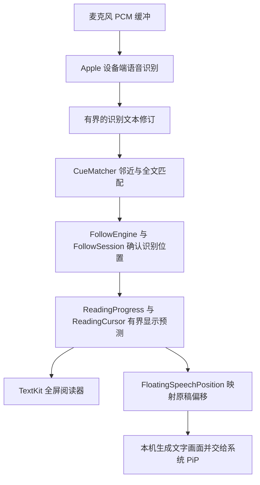

# 语音跟随与小窗实现说明

[English](TECHNICAL.md) · [简体中文](TECHNICAL.zh-CN.md) · [项目介绍](../README.zh-CN.md)

本文的 iOS 部分对应 1.0 / build 14，macOS 部分对应预览版 0.1.0 (12)。Oralo 使用 Apple 设备端语音模型识别声音，再通过本地文本对齐定位讲稿，不把讲稿发给大语言模型或服务器判断滚动位置。

## 一套流程，两种阅读界面

[`MicrophoneCapture`](../oralo-ios/Oralo/Speech/MicrophoneCapture.swift) 从音频 tap 复制单声道 PCM 样本，传入有界异步流，不写入录音文件。如果音频流溢出，会报告处理过载，避免积压成越来越迟的识别。

两种识别后端遵循相同的 [`SpeechSource`](../oralo-ios/Oralo/Speech/SpeechSource.swift) 接口：

- 受支持的 iOS 26 及以上设备：[`ModernSpeechSource`](../oralo-ios/Oralo/Speech/ModernSpeechSource.swift) 使用 `SpeechAnalyzer`、`SpeechTranscriber`、带时间信息的渐进结果及 `fastResults`。缺少系统模型时，由用户明确选择下载。
- iOS 18 兼容路径：[`LegacySpeechSource`](../oralo-ios/Oralo/Speech/LegacySpeechSource.swift) 检查 `supportsOnDeviceRecognition`，强制 `requiresOnDeviceRecognition = true`，接收中间识别结果，并在专用串行队列处理回调。识别请求续接时不重放已采集的音频。
- 设备端识别不可用时明确提示，仍可手动提词，不回退到服务器识别。

新版后端通过 [`TranscriptWindow`](../oralo-ios/Packages/OraloCore/Sources/OraloCore/TranscriptWindow.swift) 替换重叠时间段的识别结果，而不是把每次中间结果反复追加。窗口限制为最多 12 秒、32 个片段和 768 个输出字符，避免历史文本压过刚说出的内容。

## 如何跟随，以及自由发挥后接稿

[`SpeechText`](../oralo-ios/Packages/OraloCore/Sources/OraloCore/SpeechText.swift) 在保留原文字级范围的同时处理大小写、标点、常见数字表达，以及字符数不变的繁简归一化。拼音和音标作为独立注释保存，不会被当成额外正文加入匹配。

[`CueMatcher`](../oralo-ios/Packages/OraloCore/Sources/OraloCore/CueMatcher.swift) 同时利用邻近窗口和全文检索：

1. 总是检查当前句及后面三句，普通顺读无需等待整句最终识别结果。
2. 通过单词与相邻 token 索引，在全文召回最多 12 个额外候选；少见匹配具有更高检索权重。
3. 对最近识别文本的尾部执行反向编辑距离对齐，要求最新的非语气词真正匹配，避免一直依赖旧前缀而停在第一句。
4. 最佳候选与第二候选过于接近、或短语在原稿中重复出现时，拒绝贸然跳转。
5. 远距离接稿只使用上次移动之后的新语音证据。明确的唯一精确匹配可立即定位；模糊匹配需要更多增长证据或最终识别结果。

[`FollowEngine`](../oralo-ios/Packages/OraloCore/Sources/OraloCore/FollowEngine.swift) 管理匹配证据；[`FollowSession`](../oralo-ios/Packages/OraloCore/Sources/OraloCore/FollowSession.swift) 只允许普通匹配在前向窗口移动，远距离移动需要显式的重定位证据。每个异步结果带有上下文 token 和递增序号；暂停、重启或手动选句会让旧结果失效。

不确定的声音会进入保持状态。这里可能是真正的自由发挥，也可能是识别错误，App 无法可靠区分；它会保留位置，等待新证据，或由用户点按原句接回。

## 怎样减轻跟随延迟

语音识别不是瞬时完成的。Oralo 一方面减少不必要的等待，另一方面把**识别确认的位置**与**界面显示的位置**分开维护。

| 处理方式 | 作用与边界 |
| --- | --- |
| 渐进／中间识别结果 | 有用的片段到达后即可推进，不必等一句话说完；中间结果仍可能被修订。 |
| 有界音频和文本窗口 | 防止音频排队或重复文本不断累积。 |
| 索引召回候选 | 保留全文接稿能力，同时只对少量候选做较昂贵的对齐。 |
| 估算识别尾部滞后 | 用已采集音频时间减去最新识别词的结束时间，平滑并限制显示补偿量。 |
| 自适应阅读速度 | 根据新确认的 token 更新平滑语速，并限制不同语言的范围。 |
| 短距离显示预测 | 有近期声音活动和推进证据时，把显示光标适度提前。 |
| TextKit 局部更新 | 重绘受影响的文字范围，让真实阅读行停留在中上区域，不逐帧重建整篇稿件。 |

[`ReadingProgress`](../oralo-ios/Packages/OraloCore/Sources/OraloCore/ReadingProgress.swift) 的预测时间最多 **0.9 秒**，最多提前 **6 个汉字 token 或 2 个英文词**；超过一秒没有新的确认推进就停止预测。[`ReadingCursor`](../oralo-ios/Packages/OraloCore/Sources/OraloCore/ReadingCursor.swift) 还要求有声音活动，限制中英与数字边界，最多预览紧接着的下一句。静音、不确定或预测过期时保留当前显示位置，避免光标突然闪回。

全屏阅读器用下划线区分预测尾部。预测不会改写真实识别锚点，也不会把句子标记成已经确认读过。这是字级显示，不是音素级发音评分，也不代表每个字都能达到精确的 KTV 时间同步。

[`SpeechPrototypeModel`](../oralo-ios/Oralo/Prototype/SpeechPrototypeModel.swift) 分别记录回调间隔、匹配耗时与识别尾部时间差。**匹配耗时 P95 不等于从麦克风到高亮的端到端延迟**，从保持状态恢复也不等于统计过的接稿成功率。不同设备、语言和音频路由不能套用统一的延迟保证。

[`ScriptReader`](../oralo-ios/Oralo/Prototype/ScriptReader.swift) 根据实际排版后的文字行定位阅读区。旋转只重排阅读器，不替换语音会话；镜像只改变正文与注音的视觉呈现，按钮和逻辑阅读位置保持正常。

## 跨 App 小窗如何实现

小窗采用系统 AVKit PiP，并非任意跨 App 悬浮窗。build 14 的 [`FloatingContentController`](../oralo-ios/Oralo/Floating/FloatingContentController.swift) 继承 `AVPictureInPictureVideoCallViewController`，通过 `AVPictureInPictureController.ContentSource(activeVideoCallSourceView:contentViewController:)` 连接。这个类名是公开 AVKit 容器的名称；Oralo 不创建 CallKit 通话、网络视频通话或相机采集会话。

[`FloatingFrameRenderer`](../oralo-ios/Oralo/Floating/FloatingFrameRenderer.swift) 用 TextKit 排版正文和注音，再绘制到池化的 **960 × 540 BGRA 像素缓冲区**，封装成 `CMSampleBuffer`。滚动期间最多以 **15 帧／秒**更新本机画面，静止内容降低刷新频率。

帧使用 `kCMSampleAttachmentKey_DisplayImmediately`，来源显示层不设置 control timebase。App 内预览与 PiP 内容分别有显示表面；送帧前检查接收状态，渲染失败时清空渲染队列恢复。不生成 MP4 文件、网络视频流或无声保活音轨。

两种模式有明确区别：

- **定速模式**：[`FloatingReadingTimeline`](../oralo-ios/Packages/OraloCore/Sources/OraloCore/FloatingReadingTimeline.swift) 将时间映射到正文偏移，不使用麦克风。
- **语音跟随模式**：[`FloatingSpeechSession`](../oralo-ios/Oralo/Floating/FloatingSpeechSession.swift) 复用全屏的生产语音模型、匹配器和阅读光标，再由 [`FloatingSpeechPosition`](../oralo-ios/Packages/OraloCore/Sources/OraloCore/FloatingSpeechPosition.swift) 映射回原稿。小窗中的阅读底色不是另一套独立确认的逐字高亮。

### 与系统相机和录音共存

[`FloatingPromptController`](../oralo-ios/Oralo/Floating/FloatingPromptController.swift) 统一管理 PiP 音频会话：语音模式采用 `.playAndRecord`、`.measurement` 与 `.mixWithOthers`；定速模式使用可混合的 `.playback`。小窗语音采集使用外部管理的会话，避免内部再次覆盖音频配置；全屏仍保留自身的独占会话策略。

语音采集从 Oralo 前台启动，不在后台反复激活音频去争抢其他 App。出现音频中断或收不到 PCM 缓冲时保留当前位置，不会偷偷切成定速滚动并声称仍在语音跟随。无音频缓冲看门狗当前为 2.5 秒。仅收到音频中断通知，不会让无声的定速文字画面停止。

返回 Oralo 时暂停并关闭小窗。保存的位置包含稿件身份、版本和偏移；再次打开不会自动收音。删除稿件会清理位置记录，并释放对应的内存画面和会话。

build 14 已通过真机使用验收，覆盖系统相机录像、录像人声、语音跟随及自由发挥后接稿。这不代表所有录像、直播或通话 App 都兼容。PiP 可用性、位置和尺寸范围由 iOS 决定，其他 App 可能中断麦克风或终止 PiP。当前渲染器绘制不透明背景，不提供透出下层 App 画面的透明视频。

## 注音与本机存储

中文拼音来自可编辑的 Foundation 转写；英文 IPA 来自内置词典。`AVSpeechSynthesizer` 朗读原始英文单词供参考，不是把用户编辑的音标直接合成为声音。复盘中的读音核对由用户主动操作，不自动判定某个词发音错误。

稿件、注音和复盘快照本机保存。删除会协调主存档与恢复副本，防止旧写入任务或回退加载恢复已删除的内容。系统备份、导出副本等边界见[隐私与删除说明](PRIVACY.zh-CN.md)。

## 测试与验证边界

在仓库根目录运行 `swift test --package-path oralo-ios/Packages/OraloCore`。主要测试包括：

| 测试 | 覆盖内容 |
| --- | --- |
| [CueMatcherTests](../oralo-ios/Packages/OraloCore/Tests/OraloCoreTests/CueMatcherTests.swift)、[SpeechRecoveryTests](../oralo-ios/Packages/OraloCore/Tests/OraloCoreTests/SpeechRecoveryTests.swift) | 明确匹配、歧义、最新语音尾部及远距离接稿 |
| [FollowSessionTests](../oralo-ios/Packages/OraloCore/Tests/OraloCoreTests/FollowSessionTests.swift) | 暂停、手动导航、上下文失效和结果顺序 |
| [ReadingProgressTests](../oralo-ios/Packages/OraloCore/Tests/OraloCoreTests/ReadingProgressTests.swift)、[ReadingCursorTests](../oralo-ios/Packages/OraloCore/Tests/OraloCoreTests/ReadingCursorTests.swift) | 预测上限、静音、混合语言与跨句显示 |
| [FloatingReadingTests](../oralo-ios/Packages/OraloCore/Tests/OraloCoreTests/FloatingReadingTests.swift)、[FloatingSpeechPositionTests](../oralo-ios/Packages/OraloCore/Tests/OraloCoreTests/FloatingSpeechPositionTests.swift) | 定速位置、暂停与原稿坐标映射 |
| [LocalDataRemovalTests](../oralo-ios/Packages/OraloCore/Tests/OraloCoreTests/LocalDataRemovalTests.swift) | 主副本清理及中断后继续删除 |

UI 测试使用独立稿库验证备稿、注音、复盘、布局和小窗流程，不能代替真机 ASR 时延、后台收音和其他 App 成片声音测试。真机报告应注明系统、语言、音频路由及配合使用的 App，用不含隐私的文本测试快慢语速、停顿、重复句、自由发挥、手动跳句及中断。

## macOS 原生演讲页与悬浮窗

Mac 工程直接引用同一份 `OraloCore`，没有分叉匹配算法或替换 iOS build 14 的接稿逻辑。[`MacSpeechSession`](../oralo-macos/OraloMac/Speech/MacSpeechSession.swift) 管理一套本地收音会话：macOS 26 及以上使用现代 `SpeechAnalyzer` 适配器，显式兼容模式要求 `SFSpeechRecognizer` 支持设备端识别。设备端能力不可用时保留阅读位置，不偷偷启用服务器识别。

[`MacReader`](../oralo-macos/OraloMac/Reader/MacReader.swift) 使用现有的有界显示预测驱动演讲页与悬浮窗。改变悬浮窗大小或外观不会启动第二个识别器；备稿和阅读继续使用原文的注音锚点。

[`PresentationWindows`](../oralo-macos/OraloMac/Windows/PresentationWindows.swift) 通过公开的 AppKit 非激活 `NSPanel` 实现悬浮与快捷设置；[`FloatingGeometry`](../oralo-macos/OraloMac/Windows/FloatingGeometry.swift) 负责靠近摄像头、四角定位和屏幕边界恢复。透明度只影响背景，正文保持清晰。阅读偏好及窗口位置由 [`MacPreferences`](../oralo-macos/OraloMac/App/MacPreferences.swift) 保存在本机。Mac 不使用 AVKit PiP，也不为了提词建立视频通话。

非激活窗口有助于减少焦点切换，但不能保证所有会议或投屏配置都会排除提词窗。应共享具体的演示或浏览器窗口，并检查实际共享预览。当前 Mac 候选版完成了构建与安装包检查；运行时尚待确认的项目见[验证边界](../oralo-macos/VALIDATION.md)和[人工验收清单](../oralo-macos/MANUAL-ACCEPTANCE.md)。
